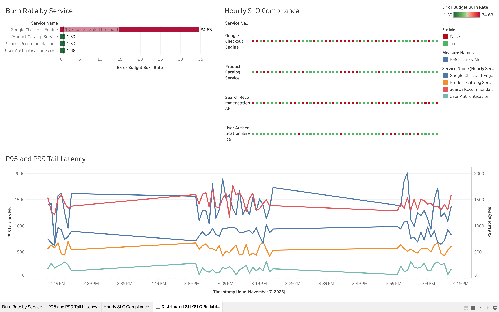

# Distributed SLI/SLO Aggregator & Error Budget Engine

An end-to-end reliability engineering pipeline that ingests simulated microservice telemetry, computes windowed Service Level Indicators (SLIs) and error budget burn rates in PostgreSQL, serves real-time health metrics via FastAPI, and exports analytical datasets for Tableau Public visualization.

## Architecture Overview

1. **Telemetry Ingestion (`ingestion/telemetry_simulator.py`)**: Generates realistic multi-service HTTP request logs across four core microservices (`User Authentication Service`, `Product Catalog Service`, `Search Recommendation API`, and `Checkout Engine`), including injected latency degradation and 5xx error spikes.
2. **Storage & Analytical Rollups (`database/`)**:
   - `init_schema.sql`: Defines relational tables (`services_master`, `raw_telemetry`, `service_hourly_rollups`) with indexing for time-series aggregation.
   - `analytical_views.sql`: Computes hourly `PERCENTILE_CONT` latency metrics (P90, P95, P99), availability percentages, and the `vw_slo_error_budget` view tracking real-time error budget burn rates.
3. **REST API Layer (`api/main.py`)**: Asynchronous FastAPI application backed by `asyncpg` connection pooling, exposing `/health`, `/api/v1/slos`, and `/api/v1/services/{service_id}/rollups`.
4. **BI & Visualization Exports (`tableau_exports/`)**: Automated CSV exports formatted for Tableau Public executive reliability dashboards.

## Tech Stack

- **Database**: PostgreSQL 18 (Window functions, `PERCENTILE_CONT`, analytical views)
- **Backend & Ingestion**: Python 3.14, FastAPI, Uvicorn, `asyncpg`, Pydantic
- **Visualization**: Tableau Public

## Quickstart

### 1. Clone & Setup Environment
```bash
git clone https://github.com
cd distributed-sli-aggregator
python3 -m venv venv
source venv/bin/activate
pip install -r requirements.txt
```

### 2. Initialize PostgreSQL & Run Telemetry Simulation
```bash
createdb sli_aggregator
psql -d sli_aggregator -f database/init_schema.sql
python ingestion/telemetry_simulator.py
psql -d sli_aggregator -f database/analytical_views.sql
```

### 3. Launch the FastAPI Server
```bash
uvicorn api.main:app --reload
```
Visit `http://localhost:8000/docs` to explore the interactive Swagger API documentation.

## Dashboard Preview


